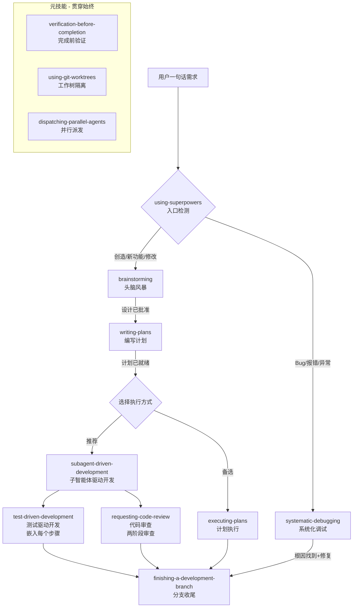

# Superpowers 新功能开发 — AI 技能路由指令

> **用途**：给 AI 读取。当用户提出「新增功能」需求时，AI 根据本指南自动调用 Superpowers 技能体系，按标准工作流开发。
>
> **适用范围**：已有项目添加新功能、修改行为、修复 Bug。仅使用 Superpowers 技能，不依赖 OpenSpec 或其他框架。
>
> **核心理念**：技能自动触发。AI 检测场景 → 自动加载技能 → 按流程执行。用户不需要手动调用任何技能。

---

## 一、Superpowers 技能体系

### 技能总览



### 技能速查表

| 技能 | 触发条件 | 核心产出 |
|------|---------|---------|
| **brainstorming** | 任何创造/新功能/修改需求 | 设计文档 `docs/superpowers/specs/*` |
| **using-git-worktrees** | 开始功能开发时自动检测 | 隔离工作树 |
| **writing-plans** | 设计已批准 | 实现计划 `docs/superpowers/plans/*` |
| **subagent-driven-development** | 计划就绪 + 任务独立 | 每个任务的代码 + 测试 |
| **executing-plans** | 计划就绪 + 无子智能体或任务紧密耦合 | 同会话直接执行 |
| **test-driven-development** | 每个编码步骤中自动嵌入 | 红-绿-重构循环 |
| **requesting-code-review** | 每个任务完成后 | 规格合规 + 代码质量两份审查报告 |
| **finishing-a-development-branch** | 所有任务完成 | 合并/PR/保留/丢弃选择 |
| **verification-before-completion** | 贯穿全程 | 每个声明的验证证据 |
| **systematic-debugging** | Bug/错误/异常行为 | 根因分析 + 修复 |
| **dispatching-parallel-agents** | 2+ 个独立问题时 | 并行处理结果汇总 |

---

## 二、需求判断决策树

读取用户需求后，按以下顺序判断：

### Step 1：判断需求类型

```
用户的输入
    │
    ├── 包含这些词 → 类型 = bugfix
    │   "Bug" / "出错" / "报错" / "挂了" / "异常" / "失败" /
    │   "不工作" / "收不到" / "加载不了" / "错误" / "500" /
    │   "闪退" / "崩溃" / "无效"
    │   → 路由到「系统化调试工作流」
    │
    ├── 包含这些词 → 类型 = optimization
    │   "优化" / "性能" / "慢" / "重构" / "重写" / "加载慢" /
    │   "卡顿" / "瓶颈" / "效率"
    │   → 先 brainstorming 确认范围，再按 feature 流程
    │
    ├── 包含这些词且数量≥2 → 类型 = parallel
    │   "多个" / "两个" / "几个" / "所有" / "批量" /
    │   且明确提到 2+ 个独立问题/功能
    │   → 路由到「并行开发工作流」
    │
    ├── 其他创建/添加/修改/实现需求 → 类型 = feature
    │   → 路由到「标准新功能工作流」
    │
    └── 不确定 → 类型 = feature
        → 先 brainstorming 澄清
```

### Step 2：评估复杂度（仅针对 feature）

读取出需求后，AI 自动评估：

```markdown
## 复杂度评估规则

### 小（S）— 30 分钟内
特征（满足任一即可）：
- 只修改 1-2 个文件
- 不新增数据模型或 API
- 不改动现有接口签名
- 示例：改文案、加按钮、改颜色、加简单字段

### 中（M）— 30-90 分钟
特征（满足任一即可）：
- 修改 3-5 个文件
- 需要新增 1 个组件/服务
- 新增 1-2 个 API 端点
- 示例：加导出功能、加搜索过滤、加表单

### 大（L）— 需拆分
特征（满足任一即可）：
- 涉及 2+ 个模块/子系统
- 需要新增数据模型 + API + 前端页面
- 影响多个现有模块
- 示例：加支付系统、加客服系统、加权限管理

### 模糊（U）— 不确定
- 用户需求表述过于模糊，无法判断
- → 直接进入 brainstorming 先澄清
```

### Step 3：路由到对应工作流

```
类型 = bugfix     → 工作流 B（系统化调试）
类型 = optimization → 工作流 C（优化/重构）
类型 = parallel    → 工作流 D（并行开发）
类型 = feature
    ├── 复杂度 = U（模糊）→ 工作流 A（Brainstorming 先行）
    ├── 复杂度 = S（小）  → 工作流 A（精简模式）
    ├── 复杂度 = M（中）  → 工作流 A（标准模式）
    └── 复杂度 = L（大）  → 工作流 A（拆分模式）
```

---

## 三、技能调用方式

### 真实机制说明

Superpowers 技能体系的执行依赖以下真实机制：

| 机制 | 说明 | 用于 |
|------|------|------|
| `Skill` 工具（Claude Code 内建） | 技能由插件直接提供，调用即加载当前版本的完整步骤 | **AI 自动调用的唯一正确方式** |
| `CLAUDE.md`（项目根目录） | 项目级系统提示词 | AI 启动时自动读取，包含路由规则 |
| `~/.claude/commands/<技能名>.md` | Claude Code 自定义斜杠命令 | 用户手动输入 `/brainstorming` 触发（可选） |

> ⚠️ **2026-10-21 更新**：本文档原先把 `SuperpowersLearn/learn/` 当作「技能定义文件」，
> 让 AI 读那里的中文教程再执行。该目录已于 2026-10-21 删除，原因：
> ① 它是 2026-06-07 写的二手转述，与插件当前版本（v7.0.0，15 个技能）已脱节；
> ② 真正的技能定义由插件随 `Skill` 工具加载，读二手笔记反而会执行到过时步骤。
> 下文所有 `SuperpowersLearn/...` 路径均已改为「用 `Skill` 工具加载同名技能」。

**AI 自调用流程：**

```
用户："加个导出 CSV 功能"
  │
  ▼ AI 读取 CLAUDE.md（或当前文档）中的路由规则
  │
  ▼ AI 执行决策树判断
  │  ├─ 类型 = feature
  │  ├─ 复杂度 = M
  │  └─ 匹配 → Brainstorming
  │
  ▼ AI 调用 Skill 工具，加载 superpowers:brainstorming
  │  （技能正文即最新版步骤，无需另读教程）
  │
  ▼ AI 完成 brainstorming → 自动过渡到 writing-plans
  │  调用 Skill 工具加载 superpowers:writing-plans
```

**你不需要输入 `/brainstorming`。** AI 自己读路由规则 → 自己加载技能 → 自己执行。

---

### 技能加载方式

技能定义由 Superpowers 插件提供，用 `Skill` 工具按名加载（名字见本文首「技能速查表」）：

```
决策树匹配到技能名   →   Skill(skill="superpowers:<技能名>")   →   按技能正文执行

brainstorming         →  superpowers:brainstorming
writing-plans         →  superpowers:writing-plans
subagent-driven-dev   →  superpowers:subagent-driven-development
test-driven-dev       →  superpowers:test-driven-development
systematic-debugging  →  superpowers:systematic-debugging
code-review           →  superpowers:requesting-code-review（请求）/ receiving-code-review（接收）
git-worktrees         →  superpowers:using-git-worktrees
finishing-branch      →  superpowers:finishing-a-development-branch
dispatching-parallel  →  superpowers:dispatching-parallel-agents
verification-before   →  superpowers:verification-before-completion
executing-plans       →  superpowers:executing-plans（无子智能体时执行计划的备选）
```

> 插件当前版本 v7.0.0 共 15 个技能，完整清单以会话中「available skills」列表为准；
> 上表只列本工作流会用到的。**不要凭记忆写技能名**，以列表中的实际名字为准。

也可以配置为 Claude Code 自定义命令（可选），让用户可手动 `/` 触发：

```
~/.claude/commands/
  ├── brainstorming.md        ← 用户可输入 /brainstorming
  ├── writing-plans.md        ← 用户可输入 /writing-plans
  ├── subagent-driven-dev.md
  ├── test-driven-dev.md
  ├── systematic-debugging.md
  ├── code-review.md
  ├── git-worktrees.md
  ├── finishing-branch.md
  └── dispatching-parallel.md
```

---

### 执行规则

```
1. AI 读取路由文档 → 判断当前应使用的技能
2. AI 用 `Skill` 工具加载对应技能（`superpowers:<技能名>`）→ 获取最新版详细步骤
3. 技能中的 Hard Gate（硬性门槛）不可绕过
   (例如：brainstorming 中 "用户批准前不能写代码")
4. 元技能 (verification-before-completion) 贯穿全程：
   每个声称"完成了"的声明之前，必须运行验证命令并读取输出
5. 技能之间的过渡：
   - 一个技能完成后，自动检测下一个应触发的技能
   - 不需要用户手动输入任何命令
```

---

## 四、工作流详解

### 工作流 A：标准新功能开发

这是最常用的工作流。根据复杂度自适应调整每步的详细程度。

#### 标准模式（复杂度 M）

```
步骤 1：Brainstorming — 需求澄清与设计
────────────────────────────────────────────────────────
触发：自动（detect 到创造性工作）
产出：docs/superpowers/specs/YYYY-MM-DD-<功能名>-design.md

AI 执行：
  1.1 探索项目上下文
      - 读取现有文件结构（用 glob/list_directory）
      - 读取主入口、数据模型、相关模块
      - 读取 .gitignore、package.json 等技术配置
      - 读取最近 5 条提交（git log --oneline -5）

  1.2 逐一提问澄清需求（每次只问一个问题）
      问题顺序（按需使用，已明确的跳过）：
      - "这个功能的核心目标是什么？"
      - "用户的交互流程是怎样的？"
      - "需要保存数据吗？存在哪里？"
      - "有 UI 展示需求吗？在哪里展示？"
      - "有没有不需要做的功能（边界）？"

  1.3 提出 2-3 种方案，附权衡分析
      每个方案包含：
      - 技术选型
      - 优缺点
      - 实施难度估算
      - 推荐方案及理由

  1.4 分节呈现设计，逐节获得用户批准
      设计章节：
      - 架构设计（模块划分、数据流）
      - 数据模型（新增/修改字段、表）
      - API 设计（如适用）
      - UI 组件树（如适用）
      - 错误处理策略
      - 测试策略

  1.5 写设计文档 → 自我审查 → 用户审查

  1.6 ★ 铁律（Hard Gate）：
      在用户批准设计前，不得写任何代码。

  1.7 过渡到 Writing Plans


步骤 2：Using Git Worktrees — 创建隔离工作环境
────────────────────────────────────────────────────────
触发：进入实现阶段前自动检测
执行：
  2.1 检测是否已在隔离工作空间中
      - 如果是 → 跳过
      - 如果否 → 询问用户："建议创建隔离工作树开发，同意吗？"

  2.2 创建 git worktree
      git worktree add .worktrees/<功能名> <新分支名>

  2.3 安装依赖、验证测试基线干净
      npm install / pip install / ...
      npm test （确认所有测试通过）


步骤 3：Writing Plans — 编写实现计划
────────────────────────────────────────────────────────
触发：设计已批准
产出：docs/superpowers/plans/YYYY-MM-DD-<功能名>.md

AI 执行：
  3.1 读取设计文档
  3.2 将功能拆分为 2-5 分钟的独立子任务
  3.3 每个任务格式：

      ### Task N: <任务名>

      **Files:**
      - Create: `src/<路径>/<文件>`
      - Modify: `src/<路径>/<文件>:行号-行号`
      - Test: `tests/<路径>/<测试文件>`

      - [ ] **Step 1: Write the failing test**
        <完整的测试代码>

      - [ ] **Step 2: Run it — verify it fails (RED)**
        ```bash
        <测试命令>
        # Expected: 1 failed, 0 passed
        ```

      - [ ] **Step 3: Implement minimal code**
        <完整的实现代码>

      - [ ] **Step 4: Run it — verify it passes (GREEN)**
        ```bash
        <测试命令>
        # Expected: 1 passed, 0 failed
        ```

      - [ ] **Step 5: Commit**
        ```bash
        git add -A && git commit -m "feat: <描述>"
        ```

  3.4 自我审查计划
      - 规格覆盖率：每个需求都有对应任务
      - 无占位符：没有 TODO/TBD/... 
      - 类型一致性：函数签名在任务间一致

  3.5 提供执行方式选择
      "计划已完成。推荐使用子智能体驱动开发（SDD）执行，还是当前会话执行？"


步骤 4：Subagent-Driven Development — 执行计划（推荐）
────────────────────────────────────────────────────────
触发：用户选择 SDD
执行：

  循环处理每个任务：

  4.1 派发执行者子智能体
      上下文：设计文档摘要 + 计划中的单个任务
      子智能体按计划步骤执行（TDD 嵌入其中）

  4.2 规格合规审查（第一阶段审查）
      派发规格审查子智能体
      - 任务输出是否满足规格文档中的每个需求？
      - 不通过 → 执行者修复 → 重新审查

  4.3 代码质量审查（第二阶段审查）
      派发质量审查子智能体
      - 架构、命名、单一职责、测试覆盖、无魔法数字
      - 不通过 → 执行者修复 → 重新审查

  4.4 标记任务完成

  4.5 ★ 铁律（Red Flags）：
      - ❌ 不能跳过规格审查直接到质量审查
      - ❌ 不能同时派发多个执行者（会冲突）
      - ❌ 不能接受"差不多"的审查通过
      - ❌ 子智能体自己不能替代正式审查


步骤 5：Final Code Review — 最终代码审查
────────────────────────────────────────────────────────
触发的：所有任务完成
执行：派发最终审查子智能体，检查整体代码一致性


步骤 6：Finishing — 分支收尾
────────────────────────────────────────────────────────
触发：所有任务完成 + 测试通过

AI 执行：
  6.1 运行完整测试套件验证通过
  6.2 检测工作环境类型（普通仓库/工作树/detached HEAD）
  6.3 确定基础分支
  6.4 提供选项给用户：
      1. 合并到本地（merge）
      2. 推送并创建 Pull Request
      3. 保留分支（以后处理）
      4. 丢弃这个工作
  6.5 执行用户选择
  6.6 清理工作空间

  6.7 ★ 铁律（Verification Before Completion）：
      "不运行验证命令 + 不读取输出 = 不能声称通过"
      每个"完成了"的声明必须有新鲜的测试运行证据。
```

#### 精简模式（复杂度 S）

当复杂度为 S（小功能）时，Brainstorming 和 Writing Plans 可以精简，但**不能跳过**：

```
步骤 1：Brainstorming（精简版）
  1.1 探索上下文（1 次读取）
  1.2 问 1 个关键问题澄清（最多 2 个问题）
  1.3 提出 1-2 个方案（不需要 3 个）
  1.4 写精简设计文档（重点在改动部分）
  1.5 用户确认后继续

步骤 2：Worktree（同标准）

步骤 3：Writing Plans（精简版）
  1-3 个任务，每个任务仍是 2-5 分钟

步骤 4：SDD 或 Executing Plans
  按计划执行

步骤 5-6：审查 + 收尾（同标准）
```

#### 拆分模式（复杂度 L）

当复杂度为 L（大功能）时，需拆分后逐个实施：

```
步骤 1：Brainstorming（完整版）
  1.1 识别独立子功能
  1.2 向用户提出拆分建议
      "这个功能可以拆分为 N 个子功能："
      - 子功能 A：<描述>（预估时间）
      - 子功能 B：<描述>（预估时间）
      - 子功能 C：<描述>（预估时间）
      依赖关系：A → B（依赖A）→ C（独立）
  1.3 逐个子功能走完整标准流程

每个子功能独立走：
  Brainstorming → Worktree → Writing Plans → SDD + TDD → CR → Finishing
         │
         ▼
  第 N 个子功能完成后 → 集成测试 → 整体 Finishing
```

---

### 工作流 B：系统化调试（Bug 修复）

```
触发条件：用户报告 Bug / 测试失败 / 异常行为

步骤 1：快速确认（Brainstorming 的简短版）
  - 问 1-2 个问题确认问题范围
  - "是所有用户都遇到？还是特定环境？"
  - "从什么时候开始的？最近有变更吗？"

步骤 2：Using Git Worktrees
  创建隔离工作树

步骤 3：Systematic Debugging（四阶段）
  ┌─────────────────────────────────────────────┐
  │ 阶段 1：根因调查                             │
  │   ├─ 读取错误信息（完整堆栈）                 │
  │   ├─ 稳定复现（确认能可靠触发）              │
  │   ├─ 检查近期变更（git diff）                │
  │   ├─ 多组件系统：每层添加诊断探针            │
  │   └─ 逆向追踪数据流                          │
  │                                             │
  │ 阶段 2：模式分析                             │
  │   ├─ 找到相同代码库中类似的工作代码          │
  │   ├─ 对比参考实现，列出所有差异              │
  │   └─ 理解依赖关系                            │
  │                                             │
  │ 阶段 3：假设与验证                           │
  │   ├─ 形成单一假设（"我认为X是根因，因为Y"）   │
  │   ├─ 最小改动测试假设（一次只改一个变量）    │
  │   └─ 验证结果                                │
  │                                             │
  │ 阶段 4：实施修复                             │
  │   ├─ 写失败测试（最小复现代码）              │
  │   ├─ 实施单一修复                            │
  │   └─ 验证 + 回归测试                         │
  └─────────────────────────────────────────────┘

步骤 4：Code Review
  派发审查子智能体

步骤 5：Finishing
  合并/PR/保留/丢弃

★ 铁律：不完成根因调查，不得提出修复方案。
★ 铁律：一次只修复一个 Bug。
```

---

### 工作流 C：优化 / 重构

```
触发条件：性能优化、代码重构

步骤 1：Brainstorming
  - 确认优化/重构的目标
  - "优化的具体指标是什么？加载时间？响应速度？内存？"
  - "当前基线是多少？期望目标是多少？"
  - 确认范围边界（什么不改）

步骤 2：Worktree

步骤 3：Writing Plans（如果有编码实现）
  或者直接执行，取决于优化类型的性质

步骤 4：Executing Plans（重构通常任务紧密耦合，不适合 SDD）
  或 SDD（如果子任务独立）

步骤 5：Code Review

步骤 6：Finishing

★ 优化必须能测量：基线数据 → 优化后数据对比。
★ 重构不允许改变外部行为：测试不通过 = 重构失败。
```

---

### 工作流 D：并行开发

```
触发条件：2+ 个独立问题（多个独立 Bug / 多个独立功能）

步骤 1：确认独立性
  判断维度：
  - 修改的文件是否重叠？→ 重叠则串行
  - 功能逻辑是否依赖？→ 依赖则串行
  - 测试是否存在共享状态？→ 共享则串行
  → 全不 → 可以并行

步骤 2：为每个问题创建一个 Task
  Task A：<问题 A 描述>
  Task B：<问题 B 描述>
  Task C：<问题 C 描述>

步骤 3：并行派发子智能体
  每个子智能体获得：
  - 自包含的上下文（不依赖其他任务）
  - 明确的问题描述
  - 明确的输出要求

步骤 4：汇总结果
  每个子智能体返回：发现了什么 + 修复了什么

步骤 5：集成验证
  运行完整测试套件

步骤 6：Finishing

★ 铁律：误判独立性 = 并行变灾难。不确定时串行。
```

---

## 四、各个技能的铁律速查

每个技能都有其不可违反的铁律。AI 在执行时必须遵守：

### Brainstorming 铁律
```
在呈现设计并获得用户批准之前，不得调用任何实现技能、
编写任何代码、搭建任何项目框架。
即使看起来再简单的项目也需要走设计流程。
```

### Writing Plans 铁律
```
每个任务必须 2-5 分钟。
不能省略代码（不能写 "..."）。
必须标注精确文件路径。
每个步骤必须包含验证命令。
```

### Subagent-Driven Development 铁律
```
不能跳过规格合规审查。
不能跳过代码质量审查。
顺序必须正确（规格→质量，不能颠倒）。
不能同时派发多个执行者（会冲突）。
不能接受"差不多"的审查通过。
```

### Test-Driven Development 铁律
```
先写失败测试 → 确认 RED → 实现代码 → 确认 GREEN。
不能先写实现再补测试。
必须看到真正的失败（不能跳步）。
```

### Systematic Debugging 铁律
```
不完成根因调查，不得提出修复方案。
一次只修一个问题。
多组件系统必须先分层诊断再深入。
```

### Verification Before Completion 铁律
```
不运行验证命令 + 不读取输出 = 不能声称通过。
"应该"、"可能"、"似乎"、"大概" = 停下验证。
```

### Finishing a Development Branch 铁律
```
合并/PR/推送前必须运行完整测试套件并确认通过。
提供 4 个选项给用户选择，不能默认合并。
```

---

## 五、AI 执行检查清单

每次开发完成后，AI 确认以下事项：

```
□ 设计文档已保存到 docs/superpowers/specs/
□ 实现计划已保存到 docs/superpowers/plans/
□ 代码已提交（每个步骤都有独立提交）
□ 每个任务都经过了规格审查 + 质量审查
□ 完整测试套件通过
□ 工作树已清理
□ 分支已合并/PR/保留/丢弃（按用户选择）
□ 向用户总结了变更内容
```

---

## 六、常见场景速查表

| 用户说 | 路由到 | 简要流程 |
|--------|--------|---------|
| "加个导出功能" | 工作流 A（标准） | Brainstorming → Worktree → Plans → SDD → CR → Finish |
| "用户收不到邮件" | 工作流 B（调试） | 确认范围 → Worktree → 系统化调试 → 修复 → CR → Finish |
| "页面加载太慢" | 工作流 C（优化） | Brainstorming 确认目标 → Worktree → 执行 → CR → Finish |
| "加个支付功能" | 工作流 A（拆分） | Brainstorming 拆子功能 → 逐个标准流程 |
| "CI 上 3 个测试挂了" | 工作流 D（并行） | 判断独立性 → 并行派发 → 汇总 → 集成验证 → Finish |
| "帮我 review 代码" | requesting-code-review | 派发审查子智能体 |
| "把按钮颜色改红" | 工作流 A（精简） | 简化 Brainstorming → Worktree → 小 Plan → 执行 → Finish |
| "不知道，你先看看" | 工作流 A（Brainstorming 先行） | 先探索上下文，再逐步引导 |

---

## 七、常见错误与处理

### AI 执行中遇到的问题处理

| 问题 | AI 应该怎么做 |
|------|-------------|
| 需求模糊，无法判断复杂度 | 进入 Brainstorming，提出第一个澄清问题 |
| 实施时发现更好的方案 | 暂停 → 更新设计文档 → 告知用户方案变更 → 继续 |
| 实施时发现范围需扩大 | 暂停 → 告知用户 → 选项A:扩大当前 / 选项B:完成当前后新建变更 |
| 测试失败 | 暂停当前步骤 → 用 Systematic Debugging 分析 → 修复 → 继续 |
| 子智能体返回 NEEDS_CONTEXT | 提供额外上下文后重新派发 |
| 子智能体返回 BLOCKED | 判断是否能自己解，否则停下询问用户 |
| 用户说"直接做"跳过设计 | ★ 不能跳过——Hard Gate 铁律。温和但坚定地解释设计的重要性 |

---

> **AI 执行要点**：读完此文档后，每次用户提出需求，先走「需求判断决策树」确定类型和复杂度，路由到对应工作流，按步骤执行。全程遵守各技能的铁律，尤其是 Brainstorming 的 Hard Gate 和 Verification Before Completion 的验证要求。每个"完成了"的声明必须有验证证据。
